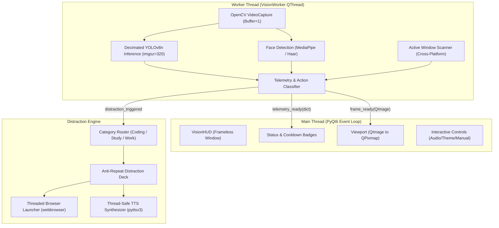

#  ANTI-PRODUCTIVITY HUD

> *The context-aware computer vision sabotaging suite designed to forcibly cure unhealthy overworking habits.*

[](https://www.python.org/)
[](https://www.riverbankcomputing.com/software/pyqt/)
[](https://github.com/ultralytics/ultralytics)
[](#how-it-distracts-you)
[](#)

---

##  The "Useless Project" Philosophy

### The Problem (that nobody asked to solve)
Modern knowledge workers and developers suffer from a dangerous addiction: **chronic productivity**. Uncontrolled urges to write clean code, study academic papers, and close Jira tickets lead to burnout, caffeine dependency, and a tragic lack of cat video consumption.

### The Solution (that nobody asked for)
**Anti-Productivity HUD** is an autonomous desktop guardian angel that uses computer vision and active window telemetry to aggressively terminate your productive flow state. 

The moment you sit down, focus on your IDE, or touch a keyboard, the HUD detects your infraction, sounds an audio alarm via text-to-speech, starts a countdown, and forcibly launches YouTube rabbit holes and anti-work relaxation sites in your default browser.

---

## 📸 Interface Showcase

### 1. Work Detected (Productivity Strike Imminent)
*The HUD detects the user's face, coding tools (keyboard, laptop), and an open code editor (`handler.py`), arming the distraction roulette with a live cooldown countdown.*

### 2. Standalone Glassmorphism Interface
*Ultra-smooth, iOS-inspired translucent card interface with real-time YOLOv8 bounding boxes, telemetry indicators, and interactive control pills.*

### 3. Slacking Protection Mode (Suppressed)
*When the user is properly slacking off on YouTube, Netflix, or Discord, the HUD displays a protective shield and withholds distractions to encourage continued procrastination.*

---

## ⚡ How It Distracts You (Key Features)

-  **Computer Vision Surveillance (`YOLOv8` + `OpenCV`)**:
  Continuously monitors your webcam feed for productivity instruments: laptops, keyboards, mice, books, and attentive human faces.
-  **Context-Aware Distraction Routing**:
  Unlike generic blockers, Anti-Productivity HUD tailors its distractions to what you are doing:
  - **Coding Hazard Detected** (VS Code, Neovim, PyCharm, Terminal): Forcibly deploys programming parodies (*Silicon Valley Tabs vs Spaces*, *Every Programming Tutorial Ever*), 10 hours of Windows XP error remixes, or Rickrolls.
  - **Studying / Reading Detected** (PDFs, research papers, documentation, physical books): Forcibly deploys existential physics rabbit holes (*Kurzgesagt*, *Veritasium*, *Vsauce*) or deep relaxation meditations.
  - **General Productivity Detected** (Excel, Slack, Jira, Trello): Deploys hilarious viral animal fails, cat malfunction videos, and epic sax loops.
-  **Autonomous Slacking Detection**:
  If your frontmost window is already YouTube, Twitch, Netflix, Reddit, or Steam, the HUD automatically suppresses itself with a `🛡️ Suppressed` status badge—congratulating you for taking work avoidance seriously.
-  **Multi-Threaded Architecture (`QThread` Decoupling)**:
  The entire computer vision inference loop (frame grabbing, YOLO prediction, Haar/MediaPipe face tracking) runs on a background worker thread. The PyQt6 main thread remains 100% responsive at 60 FPS with silky-smooth frameless dragging.
-  **Text-to-Speech Audio Shaming (`pyttsx3`)**:
  Synthesizes urgent voice warnings (*"Emergency! Excessive coding detected. Drop the IDE and touch grass immediately!"*) across your speakers to shatter your hyperfocus.
-  **Modern Glassmorphism UI**:
  Translucent frosted glass background, dynamic status pills, one-click Light/Dark theme toggle, audio mute/unmute switch, and an emergency manual `Distract Me!` button.

---

##  Prerequisites

Before installing, ensure your system meets the following requirements:

### Hardware
- **Webcam**: Standard built-in or external USB camera.
- **Audio Output**: Speakers or headphones for text-to-speech audio shaming.

### Software
- **Python**: Version `3.10` or higher (`3.11` and `3.12` fully supported).
- **Operating System**: 
  - **Windows 10 / 11** (Full support with `pygetwindow` active window tracking).
  - **Linux / Ubuntu** (Full support via standard X11/`xprop` window tracking).
  - **macOS** (Full support via native AppleScript window tracking).

---

##  Step-by-Step Setup Instructions

### 1. Clone the Repository
```bash
git clone https://github.com/your-username/anti-productivity-hud.git
cd anti-productivity-hud
```

### 2. Create a Virtual Environment

#### On Windows (PowerShell):
```powershell
python -m venv .venv
.venv\Scripts\Activate.ps1
```

#### On Linux / macOS (Bash / Zsh):
```bash
python3 -m venv .venv
source .venv/bin/activate
```

*(Optional: If you use [uv](https://github.com/astral-sh/uv), run `uv venv .venv && source .venv/bin/activate` for 10x faster installation).*

### 3. Install Dependencies
Install all required libraries via `pip`:

```bash
pip install -r requirements.txt
```

*(Note: CPU-only systems can install lightweight PyTorch to save disk space: `pip install torch --index-url https://download.pytorch.org/whl/cpu` followed by `pip install -r requirements.txt`).*

### 4. Verify YOLO Model Weight
Ensure the lightweight `yolov8n.pt` weights file is present in the project directory (included by default). If missing, download it automatically with:
```bash
python -c "from ultralytics import YOLO; YOLO('yolov8n.pt')"
```

---

##  Usage & Controls

Launch the Anti-Productivity HUD:

```bash
python app.py
```

### Interactive HUD Controls

| Control | Action | Description |
| :--- | :--- | :--- |
| **Click & Drag** | Mouse Hold & Move | Smoothly reposition the frameless HUD anywhere on your desktop screen. |
| **`☀️ LIGHT HUD`** | Click | Instantly toggles between Light Glassmorphism and Dark Frosted Glass theme. |
| **`⏱️ Cooldown`** | Status Display | Displays remaining safe seconds before the distraction roulette fires. |
| **`🔊 Audio On`** | Click | Toggles text-to-speech voice shaming on or off (great for stealth procrastination). |
| **`🎯 Distract Me!`** | Click | Emergency distraction button: immediately fires a surprise YouTube roulette. |
| **`✕` Close Pill** | Click | Safely terminates background worker threads and releases your webcam. |

---

##  Technical Architecture



---

## 🛡️ Privacy Notice
Anti-Productivity HUD processes all computer vision frames **100% locally on your machine**. No webcam footage, audio recordings, or personal data are ever uploaded, transmitted, or stored on external servers.

---

## 🤝 Contributing & Community
Got an absurdly distracting YouTube video or hilarious text-to-speech roast to add? 
Feel free to open an issue or submit a pull request!

Made with ❤️ at **TinkerHub Useless Projects**.
